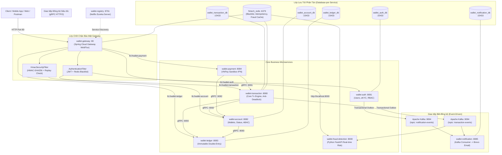

# FINTECH WALLET & PAYMENT GATEWAY MICROSERVICES
### Production-Grade Enterprise Digital Wallet, Payment Gateway & Core Financial Ledger

[](https://spring.io/projects/spring-boot)
[](https://openjdk.org/projects/jdk/21/)
[](https://fastapi.tiangolo.com/)
[](https://kafka.apache.org/)
[](https://grpc.io/)
[-336791.svg)](https://www.postgresql.org/)
[](https://redis.io/)
[-success.svg)]()

---

## I. TỔNG QUAN HỆ THỐNG (SYSTEM OVERVIEW)

Hệ thống **Ví điện tử & Cổng thanh toán tài chính doanh nghiệp** được xây dựng trên kiến trúc **Polyglot Microservices** kết hợp **Event-Driven Architecture**. Hệ thống giải quyết các bài toán khắt khe nhất trong ngành Công nghệ Tài chính (FinTech & Banking):
* **Tính toàn vẹn tài chính 100% (Zero Discrepancy):** Áp dụng nguyên lý Kế toán kép bất biến (Double-Entry Bookkeeping Ledger) với cơ chế đối soát thời gian thực ($\sum \text{Debit} + \sum \text{Credit} = 0.00$).
* **Giao tiếp tốc độ cao gRPC (HTTP/2 Binary):** Kết nối nội bộ giữa Transaction Engine, Account và Ledger với độ trễ thấp gấp 5-10 lần so với REST JSON.
* **Bảo vệ chống trừ tiền 2 lần (Idempotency Guarantee):** Sử dụng Header `X-Idempotency-Key` kết hợp Redis Lock (120s TTL).
* **Triệt tiêu nguy cơ tắc nghẽn giao dịch (Anti-Deadlock Lock Ordering):** Sắp xếp thứ tự ID tài khoản trước khi khóa song song tài nguyên (Pessimistic Lock).
* **Cam kết không rơi rớt sự kiện (Zero-Loss Event Delivery):** Áp dụng Transactional Outbox Pattern cho sự kiện chào mừng và biến động số dư.
* **Bảo mật đa tầng (Defense-in-Depth):** Chốt chặn tập trung tại API Gateway với JWT Redis Blacklist, chữ ký số HMAC-SHA256, chống Replay Attack (5 phút), phân quyền RBAC/ABAC và khống chế tối đa 3 Admin.
* **Giám sát rủi ro thời gian thực (Real-time Risk Monitoring):** Microservice Python FastAPI lắng nghe luồng sự kiện Kafka để phát hiện gian lận rửa tiền ($\ge 50M$) và spam tần suất ($> 5$ tx/phút).

---

## II. KIẾN TRÚC TỔNG THỂ (SYSTEM ARCHITECTURE)



---

## III. BẢNG TOPOLOGY HẠ TẦNG & ÁNH XẠ CỔNG (PORT MAPPING)

| Service / Hạ tầng | Công nghệ nền tảng | Cổng REST | Cổng gRPC | Trách nhiệm cốt lõi |
| :--- | :--- | :---: | :---: | :--- |
| **`wallet-gateway`** | Spring Cloud Gateway WebFlux | **`:80`** | — | Cổng vào duy nhất; HMAC-SHA256; JWT Blacklist; Aggregated Swagger |
| **`wallet-registry`** | Netflix Eureka Server | **`:8761`** | — | Service Discovery & Registry động |
| **`wallet-auth`** | Spring Boot 3.3.4, JPA | **`:8081`** | — | Người dùng, JWT, Refresh Token Rotation, eKYC, hard-cap 3 Admin |
| **`wallet-account`** | Spring Boot, gRPC Server | **`:8082`** | **`:9092`** | Thực thể Ví, Số dư thời gian thực từ Ledger, Đóng băng ví (`FROZEN`), Đóng ví (`CLOSED`) |
| **`wallet-transaction`** | Spring Boot, gRPC Server | **`:8080`** | **`:9091`** | Chuyển tiền P2P, Rút tiền, Lock Ordering chống Deadlock, Idempotency 120s |
| **`wallet-payment`** | Spring Boot, HmacSHA512 | **`:8084`** | — | Tích hợp VNPay Sandbox, Webhook IPN Server-to-Server, Callback |
| **`wallet-ledger`** | Spring Boot, gRPC Server | **`:8083`** | **`:9093`** | Sổ cái Kế toán kép bất biến (Append-Only), Đối soát Realtime $\sum \Delta = 0$ |
| **`wallet-notification`** | Spring Boot, Brevo API | **`:8085`** | — | Kafka Consumer, Gửi email HTML biên lai biến động số dư, lưu `audit_logs` |
| **`wallet-fraud-detection`**| Python 3.10+, FastAPI | **`:8000`** | — | Giám sát rủi ro Kafka: Luật High-Value & Velocity Spam, lưu Redis |
| **Apache Kafka Broker** | Confluent Kafka | **`:9094`** | — | Message broker phân tán (tránh port 9092 của Account gRPC) |
| **PostgreSQL Database** | PostgreSQL 15 | **`:15433`** | — | 5 Database độc lập per service (`fintech_postgres`) |
| **Redis Cache** | Redis 7 | **`:6379`** | — | Token Blacklist, Idempotency Lock, Fraud Cache (`fintech_redis`) |

---

## IV. CÁC NGUYÊN LÝ KỸ THUẬT CỐT LÕI (CORE PATTERNS)

### 1. Database-Per-Service & Single Source of Truth
* Bảng `accounts` trong `wallet-account` **tuyệt đối không lưu cột `balance`**.
* Số dư khả dụng của ví được tính toán động thông qua cuộc gọi gRPC sang `wallet-ledger`:
  $$\text{Balance}(\text{accountId}) = \sum_{\text{entry} \in \text{Ledger}} \text{Amount}$$
* Biến Sổ cái thành **Single Source of Truth**, ngăn chặn hoàn toàn sai lệch số dư.

### 2. Kế toán kép Bất biến (Double-Entry Immutable Ledger)
* Bảng `ledger_entries` hoạt động theo nguyên lý **Append-Only** (Chỉ thêm mới, không bao giờ có API `UPDATE` hoặc `DELETE`).
* Mỗi giao dịch sinh ra tối thiểu 2 dòng bút toán đối xứng (Nợ / Có):
  $$\sum \text{Amount} = \text{Debit} + \text{Credit} = 0.00$$
* Endpoint đối soát: `GET /api/v1/ledger/reconciliation` quét toàn bộ sổ cái; tự động kích hoạt cảnh báo nếu tổng khác `0.00`.

### 3. Thuật toán Chống Deadlock (Anti-Deadlock Lock Ordering)
* Trong giao dịch chuyển tiền giữa 2 ví A và B:
  ```java
  UUID firstLockId  = sourceId.compareTo(targetId) < 0 ? sourceId : targetId;
  UUID secondLockId = sourceId.compareTo(targetId) < 0 ? targetId : sourceId;
  ```
* Bất kể chiều chuyển tiền là $A \rightarrow B$ hay $B \rightarrow A$, hệ thống luôn yêu cầu Pessimistic Lock theo thứ tự ID nhỏ trước, ID lớn sau, **triệt tiêu 100% nguy cơ Deadlock**.

### 4. Transactional Outbox Pattern (Zero-Loss Events)
* Dữ liệu nghiệp vụ và sự kiện gửi đi được ghi đồng thời vào Database trong cùng một `@Transactional`.
* Background Worker (`OutboxEventScheduler`) quét định kỳ các sự kiện `PENDING` và đẩy sang Kafka broker. Đảm bảo cam kết **At-least-once Delivery**.

### 5. Chữ ký số HMAC-SHA256 & Chống Replay Attack
* Các API nhạy cảm (`/transfers`, `/withdrawals`) bắt buộc có `X-Signature` và `X-Timestamp`.
* Gateway lưu đệm Request Body bằng Reactive DataBuffer để tính toán HMAC-SHA256 mà không làm mất body của downstream service (`ServerHttpRequestDecorator` + `Flux.defer()`).
* Chặn đứng Replay Attack nếu `|currentTime - requestTime| > 5 phút`.

---

## V. DANH SÁCH 31 APIS NGHIỆP VỤ (100% TESTED)

Hệ thống bao phủ trọn vẹn 31 APIs theo đặc tả tại [`docs/FUNCTION-LIST.md`](docs/FUNCTION-LIST.md):
1. **Module 1 (`wallet-auth`):** 13 APIs (Đăng ký, Đăng nhập, Token Rotation, Đăng xuất Redis Blacklist, `/me`, Đổi mật khẩu, eKYC Re-submit, Quản trị Users, Phân quyền Role, Thẩm định eKYC, Xóa mềm tài khoản).
2. **Module 2 (`wallet-account`):** 7 APIs + `/me` (Tra cứu ví `/me`, Tra cứu người nhận theo SĐT, Quản trị danh sách ví, Chi tiết số dư từ Ledger, Đóng băng ví `FROZEN`, Đóng ví `CLOSED` khi số dư = 0).
3. **Module 3 (`wallet-transaction`):** 5 APIs (Chuyển tiền P2P, Rút tiền ngân hàng, Lịch sử giao dịch cá nhân ABAC, Quản trị toàn bộ giao dịch, Chi tiết một giao dịch).
4. **Module 4 (`wallet-payment`):** 3 APIs (Sinh URL nạp tiền VNPay Sandbox, Webhook IPN Server-to-Server, Return Callback URL).
5. **Module 5 (`wallet-ledger`):** 2 APIs (Đối soát cân bằng Kế toán kép `totalDelta = 0.00`, Danh sách bút toán Sổ cái kiểm toán).
6. **Module 6 (`wallet-fraud-detection`):** 1 API (Tra cứu danh sách cảnh báo gian lận `/api/v1/fraud/alerts` từ Redis).

---

## VI. HƯỚNG DẪN KHỞI CHẠY (QUICK START)

### 1. Yêu cầu môi trường (Prerequisites)
* Java 21 LTS (OpenJDK / Eclipse Adoptium)
* Python 3.10+
* Docker & Docker Compose
* Gradle 8.x (hoặc dùng `./gradlew` có sẵn)

### 2. Khởi động Hạ tầng Container (Docker Compose)
Khởi chạy PostgreSQL (Port 15433), Redis (Port 6379), Zookeeper và Kafka (Port 9094):
```bash
docker compose -f docker/docker-compose.yml up -d
```

### 3. Nạp Cơ sở Dữ liệu & Dữ liệu Hạt giống (Seed Data)
Kết nối vào PostgreSQL cổng `15433` (user: `postgres`, pass: `postgres123`) và thực thi file:
```bash
docs/DB.sql
```

### 4. Khởi chạy các Microservices theo thứ tự
```bash
# 1. Service Discovery
./gradlew :wallet-registry:bootRun

# 2. API Gateway
./gradlew :wallet-gateway:bootRun

# 3. Core Business Services
./gradlew :wallet-auth:bootRun
./gradlew :wallet-account:bootRun
./gradlew :wallet-ledger:bootRun
./gradlew :wallet-transaction:bootRun
./gradlew :wallet-payment:bootRun
./gradlew :wallet-notification:bootRun

# 4. Python Fraud Detection Service
cd wallet-fraud-detection
pip install -r requirements.txt
uvicorn main:app --host 0.0.0.0 --port 8000 --reload
```

---

## VII. TRUNG TÂM TÀI LIỆU API & KIỂM THỬ TẬP TRUNG (SWAGGER UI)

Truy cập Swagger UI tập trung gom toàn bộ tài liệu OpenAPI của cả 6 modules tại một địa chỉ duy nhất:
**`http://localhost:80/swagger-ui.html`**

### Tài khoản Kiểm thử có sẵn (Seed Accounts):
*  **Super Admin:** SĐT `0987111222` | Mật khẩu: `Password@123`
*  **Kiểm toán viên (Auditor):** SĐT `0987444555` | Mật khẩu: `Password@123`
*  **Khách hàng VIP (Đã eKYC):** SĐT `0987333444` | Mật khẩu: `NewPassword@456`
*  **Khách hàng Mới:** SĐT `0346921795` | Mật khẩu: `Password@123`

*(Chi tiết danh sách 10 tài khoản kiểm thử xem tại [`docs/TEST-ACCOUNTS.md`](docs/TEST-ACCOUNTS.md))*.

---

## VIII. CẤU TRÚC THƯ MỤC DỰ ÁN (PROJECT STRUCTURE)

```
fintech-wallet-microservices/
├── docker/                             # Cấu hình Docker Compose (Kafka, Postgres, Redis)
├── docs/                               # Tài liệu thiết kế & phân tích hệ thống
│   ├── ARCHITECTURE.md                 # Kiến trúc chi tiết, Topology & Error Codes
│   ├── AUTHORIZE.md                    # Ma trận phân quyền 31 APIs (RBAC & ABAC)
│   ├── DB.sql                          # Schemas 5 Databases & Seed Data hoàn chỉnh
│   ├── FUNCTION-LIST.md                # Danh sách 31 chức năng & Ràng buộc nghiệp vụ
│   ├── PROJECT-STRUCTURE.md            # Cấu trúc modules và trách nhiệm phân hệ
│   ├── ROADMAP.md                      # Lộ trình bảo vệ đồ án & bộ câu hỏi vấn đáp
│   ├── TEST-ACCOUNTS.md                # Danh sách 10 tài khoản kiểm thử chuẩn doanh nghiệp
│   └── testing/                        # Kịch bản kiểm thử chi tiết 6 phân hệ (01 - 06)
├── http-test/                          # File kiểm thử REST E2E (IntelliJ HTTP Client)
├── wallet-common/                      # Thư viện dùng chung (ApiResponse, ErrorCode, Outbox)
├── wallet-grpc/                        # Protocol Buffers (.proto) & stubs HTTP/2
├── wallet-registry/                    # Netflix Eureka Server (:8761)
├── wallet-gateway/                     # Spring Cloud Gateway WebFlux (:80)
├── wallet-auth/                        # Dịch vụ Quản lý người dùng, eKYC, JWT (:8081)
├── wallet-account/                     # Dịch vụ Quản lý Ví & Số dư (:8082, gRPC :9092)
├── wallet-transaction/                 # Core Engine Chuyển/Rút tiền (:8080, gRPC :9091)
├── wallet-ledger/                      # Sổ cái Kế toán kép bất biến (:8083, gRPC :9093)
├── wallet-payment/                     # Cổng thanh toán VNPay Sandbox (:8084)
├── wallet-notification/                # Kafka Consumer gửi email Brevo (:8085)
└── wallet-fraud-detection/             # Python FastAPI Giám sát gian lận (:8000)
```

---

## IX. ĐỊNH HƯỚNG PHÁT TRIỂN TIẾP THEO (ROADMAP)

- [ ] **Containerization Toàn diện:** Viết `Dockerfile` nhiều giai đoạn (Multi-stage build) và gom toàn bộ 6 microservices vào file `docker-compose.prod.yml` chạy một lệnh duy nhất.
- [ ] **Triển khai Kubernetes (K8s):** Viết K8s manifests (Deployment, Service, Ingress, ConfigMap, Secrets, HPA) để sẵn sàng mở rộng quy mô tự động.
- [ ] **Observability Tập trung:** Tích hợp Prometheus & Grafana theo dõi metrics giao dịch (RPS, Latency, Error Rate) và OpenTelemetry / Zipkin truy vết phân tán (Distributed Tracing).
- [ ] **CI/CD Pipeline:** Tự động kiểm thử Unit/Integration Tests và build Docker image qua GitHub Actions.
