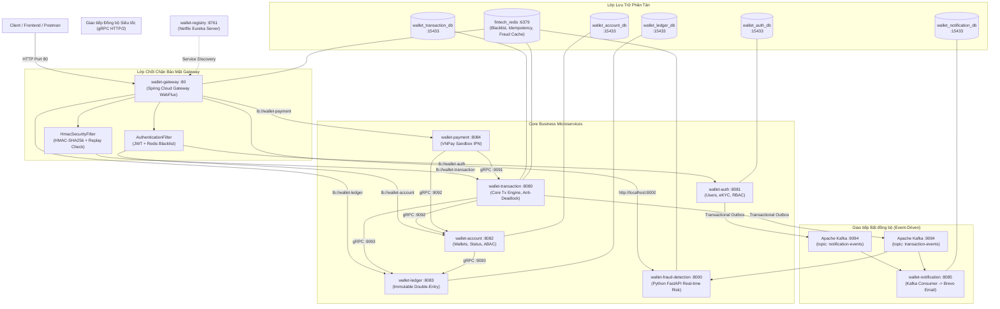

# KIẾN TRÚC HỆ THỐNG - FINTECH WALLET & PAYMENT GATEWAY

Tài liệu này định nghĩa cấu trúc, quy tắc và nguyên lý kiến trúc của toàn bộ dự án Fintech Wallet & Payment Gateway phục vụ báo cáo và bảo vệ đồ án tốt nghiệp.

---

## I. MÔ HÌNH KIẾN TRÚC TỔNG THỂ (POLYGLOT MICROSERVICES & EVENT-DRIVEN)

Hệ thống áp dụng kiến trúc **Polyglot Microservices** hoàn chỉnh kết hợp **Event-Driven Architecture**:



---

## II. BẢNG TOPOLOGY HẠ TẦNG & ÁNH XẠ CỔNG (PORT MAPPING)

| Tên Dịch vụ / Hạ tầng | Công nghệ | Cổng REST (HTTP) | Cổng Nội bộ (gRPC) | Trách nhiệm chính |
| :--- | :--- | :---: | :---: | :--- |
| **`wallet-gateway`** | Spring Cloud Gateway WebFlux | **:80** | — | Chốt chặn bảo mật duy nhất, HMAC-SHA256, JWT Blacklist, Aggregated Swagger |
| **`wallet-registry`** | Spring Cloud Eureka | **:8761** | — | Quản lý phát hiện và đăng ký dịch vụ động |
| **`wallet-auth`** | Spring Boot 3.3.4, JPA | **:8081** | — | Quản lý người dùng, JWT, Refresh Token, eKYC, RBAC/ABAC, hard-cap 3 Admin |
| **`wallet-account`** | Spring Boot, gRPC Server | **:8082** | **:9092** | Quản lý thực thể Ví, Số dư thời gian thực, Đóng băng ví, Soft Delete ví |
| **`wallet-transaction`** | Spring Boot, gRPC Server | **:8080/8083**| **:9091** | Trái tim xử lý Chuyển/Rút tiền, Anti-Deadlock, Idempotency Redis, Outbox |
| **`wallet-payment`** | Spring Boot | **:8084** | — | Tích hợp VNPay Sandbox, Webhook IPN, Return Callback, resolve ví tự động |
| **`wallet-ledger`** | Spring Boot, gRPC Server | **:8083** | **:9093** | Ghi sổ kế toán kép bất biến (Append-Only), Đối soát tài chính Realtime $\sum \Delta = 0$ |
| **`wallet-notification`** | Spring Boot, Brevo | **:8085** | — | Kafka Consumer, Gửi email HTML biên lai ngân hàng, audit_logs |
| **`wallet-fraud-detection`**| Python 3.10+ FastAPI | **:8000** | — | Giám sát rủi ro Kafka: Luật High-Value & Velocity, `/alerts` |
| **Apache Kafka Broker** | Confluent Kafka | **:9094** | — | Message broker phân tán cho các sự kiện bất đồng bộ |
| **PostgreSQL Database** | PostgreSQL 15 | **:15433** | — | Database độc lập per service (5 DBs) |
| **Redis Cache** | Redis 7 | **:6379** | — | Token Blacklist, Idempotency Lock, Fraud Audit Cache |

---

## III. NGUYÊN LÝ THIẾT KẾ & GIẢI THUẬT CỐT LÕI (CORE ARCHITECTURAL PATTERNS)

### 1. Database-Per-Service & Single Source of Truth
- Mỗi Microservice sở hữu riêng một cơ sở dữ liệu. Không service nào được truy vấn trực tiếp vào database của service khác.
- Bảng `accounts` trong `wallet-account` **tuyệt đối không lưu cột `balance`**. Bất kỳ lúc nào cần biết số dư, hệ thống gọi gRPC sang `wallet-ledger` để tính tổng đại số lũy kế các bút toán trong `ledger_entries`. Điều này biến Sổ cái thành **Single Source of Truth**, ngăn chặn hoàn toàn sai lệch số dư.

### 2. Nguyên lý Kế toán kép Bất biến (Double-Entry Bookkeeping & Immutable Ledger)
- Bảng `ledger_entries` được thiết kế theo cơ chế **Append-Only**: Không cung cấp bất kỳ API nào để cập nhật (`UPDATE`) hay xóa (`DELETE`) dữ liệu sổ cái.
- Mỗi giao dịch chuyển tiền hoặc nạp tiền đều sinh ra ít nhất 2 dòng bút toán đối ứng:
  $$\sum \text{Amount} = \text{Debit} + \text{Credit} = 0.00$$
- Thuật toán Đối soát Tài chính (`GET /api/v1/ledger/reconciliation`): Quét toàn bộ bảng `ledger_entries` theo chu kỳ hoặc theo yêu cầu, tính tổng đại số. Nếu tổng khác `0.00`, hệ thống tự động kích hoạt cảnh báo nghiêm trọng `UNBALANCED_CRITICAL_ERROR`.

### 3. Transactional Outbox Pattern (Giải quyết bài toán Dual-Write)
- Khi thực hiện giao dịch, việc vừa ghi vào DB vừa phát message lên Kafka nếu thực hiện trực tiếp sẽ dễ dẫn đến mất mát dữ liệu hoặc không đồng nhất nếu mạng lag.
- **Giải pháp:** Lưu event vào bảng `outbox_events` trong **cùng một Database Transaction** với dữ liệu nghiệp vụ. Một Background Worker (`OutboxEventScheduler`) định kỳ quét các event có trạng thái `PENDING` và bắn lên Kafka, sau đó cập nhật thành `PROCESSED`. Đảm bảo cam kết **At-least-once Delivery (Zero-Loss Event)**.

### 4. Thuật toán Chống Deadlock (Anti-Deadlock Lock Ordering)
- Trong giao dịch chuyển tiền P2P giữa hai tài khoản A và B: Nếu luồng 1 chuyển từ A sang B (khóa A rồi khóa B), đồng thời luồng 2 chuyển từ B sang A (khóa B rồi khóa A), Deadlock sẽ xảy ra.
- **Giải pháp:** Sắp xếp thứ tự ID tài khoản trước khi yêu cầu Pessimistic Lock:
  ```java
  UUID firstLockId = sourceId.compareTo(targetId) < 0 ? sourceId : targetId;
  UUID secondLockId = sourceId.compareTo(targetId) < 0 ? targetId : sourceId;
  ```
  Cả hai luồng sẽ luôn luôn tranh chấp khóa theo cùng một thứ tự duy nhất, triệt tiêu 100% nguy cơ xảy ra Deadlock.

### 5. Cơ chế Idempotency & Chữ ký số HMAC-SHA256
- **Idempotency:** Client bắt buộc truyền `X-Idempotency-Key` (UUID) trong header. Server sử dụng Redis Lock `SETNX` với TTL 120 giây. Nếu một request thứ hai có cùng key gửi đến trong lúc giao dịch đang xử lý hoặc đã xong, hệ thống lập tức từ chối (`IDEMPOTENCY_KEY_DUPLICATED` - 3002).
- **HMAC-SHA256:** Client ký gói tin bằng chuỗi secret key. Gateway tái tạo body bằng Reactive DataBuffer, tính toán lại hash và đối chiếu với `X-Signature`. Kèm theo kiểm tra `X-Timestamp` không được lệch quá 5 phút so với đồng hồ Gateway để chống Replay Attack.

---

## IV. BẢNG MÃ LỖI TẬP TRUNG TOÀN HỆ THỐNG (ERROR CODES)

| Dải mã | Phân vùng Nghiệp vụ | Mã lỗi | HTTP Status | Mô tả chi tiết |
| :--- | :--- | :---: | :---: | :--- |
| **1000 - 1999** | **Common** | `1000` | 400 | Dữ liệu đầu vào sai định dạng (Bean Validation) |
| | | `1001` | 400 | Request body rỗng hoặc sai cấu trúc JSON |
| | | `1999` | 500 | Lỗi hệ thống ngoài dự kiến |
| **2000 - 2999** | **Account / Ví** | `2001` | 404 | Tài khoản ví không tồn tại |
| | | `2002` | 409 | Người dùng đã có loại ví này |
| | | `2003` | 403 | Tài khoản ví đang bị đóng băng khẩn cấp (`FROZEN`) |
| | | `2004` | 403 | Tài khoản ví đã bị đóng vĩnh viễn (`CLOSED`) |
| | | `2005` | 404 | Không tìm thấy ví người nhận hoặc ví người nhận không khả dụng |
| | | `2006` | 400 | Không thể chuyển tiền hoặc tra cứu chính ví của bạn làm người nhận |
| | | `2007` | 400 | Trạng thái tài khoản ví không hợp lệ |
| | | `2008` | 400 | Không thể đóng ví khi số dư vẫn còn tiền (`balance > 0`) |
| **3000 - 3999** | **Transaction** | `3001` | 400 | Số dư khả dụng không đủ |
| | | `3002` | 409 | Trùng khóa Idempotency Key (Giao dịch đang xử lý) |
| | | `3003` | 404 | Không tìm thấy mã giao dịch |
| **4000 - 4999** | **Auth / User** | `4001` | 409 | Số điện thoại đã được đăng ký |
| | | `4002` | 401 | Sai số điện thoại hoặc mật khẩu |
| | | `4003` | 404 | Không tìm thấy thông tin người dùng |
| | | `4004` | 403 | Tài khoản của bạn đã bị khóa (`BLOCKED`) |
| | | `4005` | 400 | Mật khẩu hiện tại không chính xác |
| | | `4006` | 409 | Số CCCD/Hộ chiếu này đã được đăng ký |
| | | `4007` | 409 | Hồ sơ eKYC đang ở trạng thái chờ duyệt |
| | | `4008` | 400 | Quản trị viên không thể tự khóa chính mình |
| | | `4009` | 400 | Không có quyền khóa Quản trị viên khác |
| | | `4010` | 400 | Quản trị viên không thể tự hạ quyền của chính mình |
| | | `4011` | 400 | Không có quyền thay đổi vai trò của Quản trị viên khác |
| | | `4012` | 400 | Chỉ phê duyệt hồ sơ eKYC đang ở trạng thái PENDING |
| | | `4014` | 403 | Tài khoản đã bị xóa vĩnh viễn (`DELETED`) |
| | | `4015` | 400 | Quản trị viên không thể tự xóa chính mình |
| | | `4016` | 400 | Không có quyền xóa Quản trị viên khác |
| | | `4017` | 400 | Mật khẩu mới không được trùng mật khẩu cũ |
| | | `4018` | 400 | Đạt giới hạn tối đa Quản trị viên (Tối đa 3 Admin) |
| **5000 - 5999** | **Security** | `5001` | 401 | Thiếu Access Token hoặc Token hết hạn |
| | | `5002` | 401 | Token đã bị thu hồi trong Redis Blacklist sau khi Logout |
| | | `5003` | 403 | Không có quyền hạn RBAC hoặc vi phạm nguyên tắc Chính chủ (ABAC) |
