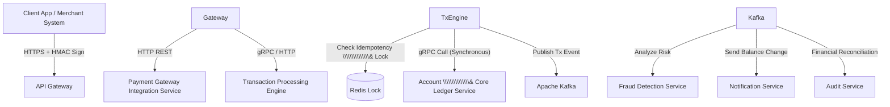

# ĐỀ TÀI 5: HỆ THỐNG VÍ ĐIỆN TỬ VÀ CỔNG THANH TOÁN NỘI BỘ DOANH NGHIỆP (FINTECH WALLET \& PAYMENT GATEWAY)

## 1\. TỔNG QUAN VỀ ĐỀ TÀI

* **Tên đề tài:** Thiết kế hệ thống Ví điện tử và Cổng thanh toán tài chính doanh nghiệp (FinTech Core System) trên kiến
  trúc Microservices.
* **Mô tả:** Hệ thống quản lý tài khoản ví, nạp/rút/chuyển tiền, xử lý thanh toán hóa đơn, tích hợp đối soát tài chính
  tự động, phát hiện giao dịch bất thường (Fraud Detection) và ghi sổ kế toán kép (Double-Entry Bookkeeping Ledger).
* **Tính thực tế doanh nghiệp:**

    * Yêu cầu độ chính xác tuyệt đối 100% về mặt dữ liệu tài chính (Zero Financial Error toleration).
    * Đòi hỏi xử lý giao dịch song song (Concurrency), chống giao dịch trùng lặp (Idempotency Control) và đảm bảo tính
      nhất quán dữ liệu phân tán trong ngành Ngân hàng / Ví điện tử (VNPay, MoMo, PayOS).

\---

## 2\. PHÂN TÍCH KIẾN TRÚC MICROSERVICES

### 2.1. Danh sách các Microservices chính

1. **API Gateway \& Security Proxy:**

    * Kiểm tra chữ ký số (Request Digital Signature HMAC-SHA256) của từng request để chống chỉnh sửa dữ liệu trên đường
      truyền (Man-in-the-middle Attack).
    * Rate limiting nghiêm ngặt theo IP / User ID.
2. **Account \& Core Ledger Service (Ghi sổ Kế toán Kép):**

    * Quản lý số dư tài khoản người dùng, tài khoản hệ thống (System Master Account).
    * Thực hiện quy tắc Kế toán kép (Mỗi giao dịch phải có ít nhất 1 dòng Nợ - Debit và 1 dòng Có - Credit với tổng bằng
      0).
    * *Database:* PostgreSQL (Yêu cầu khắt khe về thuộc tính ACID \& Isolation level `REPEATABLE READ` /
      `SERIALIZABLE`).
3. **Transaction Processing Engine (Core Engine):**

    * Tiếp nhận lệnh chuyển tiền/thanh toán, kiểm tra số dư, thực hiện giao dịch chuyển khoản giữa các ví.
    * Kiểm tra **Idempotency Key** để tránh trừ tiền 2 lần khi người dùng ấn nút chuyển tiền liên tiếp.
    * *Giao tiếp nội bộ:* gRPC (HTTP/2) để giao tiếp với Ledger Service với tốc độ cao nhất.
    * *Database:* Redis (Lock giao dịch tài khoản) + PostgreSQL.
4. **Payment Gateway Integration Service:**

    * Kết nối với Ngân hàng / Cổng thanh toán bên thứ ba (Stripe, VNPay, VietQR API).
    * Xử lý Webhook callback báo trạng thái nạp tiền.
    * *Database:* MongoDB hoặc PostgreSQL.
5. **Fraud Detection \& Risk Management Service:**

    * Phân tích luồng giao dịch thời gian thực để phát hiện các hành vi bất thường (Ví dụ: Chuyển tiền liên tục 10 lần
      trong 1 phút, hoặc chuyển số tiền bất thường từ địa điểm IP lạ).
    * *Technology Stack:* Python (FastAPI / Scikit-learn) hoặc Go rule engine.
6. **Notification \& Audit Service:**

    * Gửi biến động số dư (Email / Push Notification / SMS OTP) và lưu trữ nhật ký đối soát tài chính không thể chỉnh
      sửa (Immutable Audit Logs).
    * *Database:* Elasticsearch / TimescaleDB.

### 2.2. Sơ đồ kiến trúc \& Cơ chế giao tiếp (Inter-Service Communication)



* **gRPC cho giao tiếp đồng bộ nội bộ (Internal High-Speed Communication):**

    * Giữa `Transaction Engine` và `Ledger Service` sử dụng **gRPC (Protocol Buffers)** giúp giảm 70% kích thước payload
      và tăng tốc độ xử lý gấp 5-10 lần so với JSON/HTTP REST.
* **Tính Không lặp lại (Idempotency Guarantee):**

    * Mọi request giao dịch tài chính phải gửi kèm header `X-Idempotency-Key: <UUID>`.
    * Service sẽ kiểm tra Redis trước khi xử lý, nếu Key đã tồn tại -> Trả về ngay kết quả giao dịch trước đó mà không
      thực thi lại lệnh trừ tiền.

\---

## 3\. HƯỚNG DẪN TÌM HIỂU VÀ PHÂN TÍCH HỆ THỐNG CHO SINH VIÊN

### Giai đoạn 1: Tìm hiểu Nguyên lý Kế toán Kép (Double-Entry Bookkeeping)

1. **Thiết kế Bảng Sổ cái (Ledger Entry Table):**

    * Sinh viên cần thiết kế DB sao cho một giao dịch luôn có 2 dòng bản ghi trong bảng `ledger\\\\\\\\\\\\\\\_entries`:

        * Account A: Amount = -100.000 VNĐ (Debit)
        * Account B: Amount = +100.000 VNĐ (Credit)
    * Không được dùng câu lệnh `UPDATE balance = balance - 100000` trực tiếp mà phải tính số dư bằng tổng tất cả các
      `ledger\\\\\\\\\\\\\\\_entries` (hoặc cập nhật Snapshot kèm Ledger Entry audit).

### Giai đoạn 2: Xử lý Chống tranh chấp tài nguyên (Concurrency \& Deadlock Prevention)

1. **Phân tích bài toán Chuyển tiền qua lại:**

    * User A chuyển tiền cho User B đồng thời User B chuyển tiền cho User A.
    * Tìm hiểu cách sắp xếp thứ tự Lock tài khoản theo ID (Lock Ordering) để tránh xảy ra tình trạng **Deadlock** trong
      Database.

### Giai đoạn 3: Phân tích Cơ chế Chống giả mạo dữ liệu (Digital Signature)

1. **Xác thực chữ ký HMAC:**

    * Sinh viên thực hành tính toán chuỗi Hash `HMAC-SHA256(payload, secret\\\\\\\\\\\\\\\_key)` từ phía Client và kiểm
      tra lại chữ ký tại API Gateway.

\---

## 4\. HƯỚNG DẪN TRIỂN KHAI LÊN SERVER VPS THỰC TẾ

### Step 1: Chuẩn bị Hạ tầng VPS

* **Cấu hình VPS đề xuất:** Cloud VPS (Ubuntu 22.04 LTS, 4 vCPU, 8GB RAM, SSD 50GB).
* **Security Baseline:** Khóa chặt SSH với SSH Key (tắt password login), cấu hình UFW Firewall cẩn thận.

### Step 2: Cấu hình gRPC \& Protobuf Build Pipeline

Đóng gói Proto file và biên dịch tự động trong quá trình Build Docker:

```dockerfile
# Dockerfile ví dụ cho gRPC Service bằng Go
FROM golang:1.22-alpine AS builder
RUN apk add --no-cache protobuf-dev
WORKDIR /app
COPY go.mod go.sum ./
RUN go mod download
COPY . .
RUN go build -o ledger-service ./cmd/main.go

FROM alpine:latest
WORKDIR /app
COPY --from=builder /app/ledger-service .
EXPOSE 50051
CMD \\\\\\\\\\\\\\\["./ledger-service"]
```

### Step 3: Cấu hình Nginx Proxy cho cả HTTP REST và gRPC (HTTP/2)

Nginx phiên bản mới hỗ trợ proxy trực tiếp giao thức gRPC qua HTTP/2:

```nginx
# Cấu hình gRPC Proxy
server {
    listen 443 ssl http2;
    server\\\\\\\\\\\\\\\_name grpc-ledger.yourdomain.com;

    ssl\\\\\\\\\\\\\\\_certificate /etc/letsencrypt/live/grpc-ledger.yourdomain.com/fullchain.pem;
    ssl\\\\\\\\\\\\\\\_certificate\\\\\\\\\\\\\\\_key /etc/letsencrypt/live/grpc-ledger.yourdomain.com/privkey.pem;

    location /ledger.LedgerService/ {
        grpc\\\\\\\\\\\\\\\_pass grpc://localhost:50051;
        error\\\\\\\\\\\\\\\_page 502 = /error502grpc;
    }
}
```

### Step 4: Triển khai Quy trình CI/CD Nghiêm ngặt

1. **Tự động chạy Unit Test \& Integration Test:** Trước khi deploy lên VPS, GitHub Actions phải chạy bộ test kiểm tra
   kế toán kép và test Idempotency.
2. **Blue/Green Deployment hoặc Canary Deployment:** Đảm bảo khi nâng cấp service tài chính không bị rơi mất bất kỳ giao
   dịch nào đang xử lý dở dang.

### Step 5: Monitoring \& Alerting Tài chính

* Cấu hình Prometheus + Grafana cảnh báo qua Telegram / Email ngay lập tức nếu:

    * Tỷ lệ giao dịch thất bại > 2%.
    * Tổng số tiền Debit không bằng tổng số tiền Credit trong Sổ cái.

\---

## 5\. TIÊU CHÍ ĐÁNH GIÁ \& YÊU CẦU BÀI LÀM CHO SINH VIÊN

1. **Tính Toàn vẹn Tài chính (Financial Integrity):** Chứng minh thiết kế DB và Code tuân thủ đúng nguyên tắc Kế toán
   kép, không bị lệch tiền trong mọi trường hợp.
2. **Xử lý Idempotency \& Concurrency:** Thực hiện gửi 100 requests chuyển tiền giống hệt nhau cùng một lúc, hệ thống
   chỉ trừ tiền đúng 1 lần duy nhất.
3. **Hiệu năng gRPC:** Giao tiếp giữa Transaction Engine và Ledger Service chạy qua gRPC mượt mà trên VPS.
4. **Kịch bản Demo:**

    * Giả lập luồng nạp tiền từ Ngân hàng (qua Webhook) -> Cộng tiền ví.
    * Chuyển tiền giữa 2 ví -> Kiểm tra Sổ cái biến động.
    * Demo gửi request thiếu chữ ký HMAC hoặc sai Idempotency Key -> Hệ thống từ chối xử lý an toàn.

