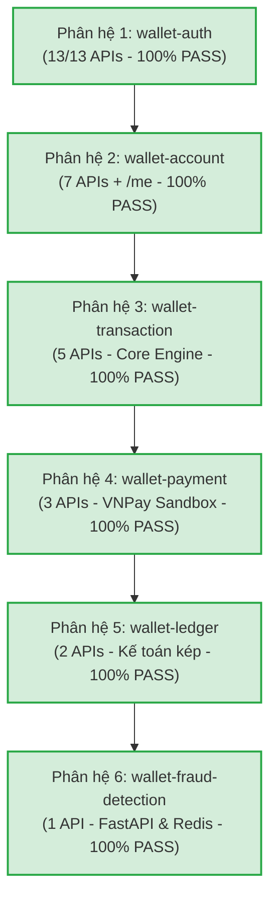

# FINTECH WALLET & PAYMENT GATEWAY - LỘ TRÌNH PHÁT TRIỂN & CHUẨN ĐẦU RA ĐỒ ÁN

Tài liệu này theo dõi tiến độ thực tế dựa trên các yêu cầu khắt khe của hệ thống Fintech Microservices phục vụ báo cáo và bảo vệ đồ án tốt nghiệp.

---

## PHẦN 1: TỔNG KẾT TIẾN ĐỘ THỰC TẾ (100% HOÀN TẤT - 31/31 APIS)



### 1. Nền tảng Hạ tầng & Bảo mật (100% ĐÃ HOÀN THÀNH)
- [x] **Service Discovery**: Netflix Eureka Server (`:8761`).
- [x] **Database per Service**: 5 Schemas độc lập trên PostgreSQL 15 (`:15433`).
- [x] **Giao tiếp tốc độ cao gRPC (HTTP/2)**: `wallet-account` (:9092), `wallet-ledger` (:9093), `wallet-transaction` (:9091).
- [x] **Message Broker Kafka (`:9094`)**: Trao đổi sự kiện `notification-events` và `transaction-events`.
- [x] **Transactional Outbox Pattern**: Đảm bảo Zero-Loss event khi chuyển tiền hoặc đăng ký tài khoản.
- [x] **HMAC-SHA256 Digital Signature**: Xác thực tính toàn vẹn payload và chống Replay Attack tại API Gateway (`:80`).
- [x] **Idempotency Guarantee**: Header `X-Idempotency-Key` + Redis khóa giao dịch chống trừ tiền 2 lần.
- [x] **Anti-Deadlock Mechanism**: Sắp xếp thứ tự ID tài khoản (Lock Ordering) khi khóa song song 2 ví P2P.
- [x] **Centralized Swagger UI Aggregator**: Cổng `:80/swagger-ui.html` gom tài liệu của cả 6 modules (bao gồm Python FastAPI qua OpenAPI proxy).

### 2. Danh mục 6 Microservices Nghiệp vụ (31/31 APIs - 100% PASS)
- [x] **Phân hệ 1: `wallet-auth` (13/13 APIs)**: Đăng ký, Đăng nhập, Token Rotation, Đăng xuất Redis Blacklist, `/me`, Đổi mật khẩu, eKYC Re-submit, Quản trị Users, Phân quyền Role (tối đa 3 Admin), Thẩm định eKYC, Xóa mềm tài khoản.
- [x] **Phân hệ 2: `wallet-account` (7 APIs + `/me`)**: Tra cứu ví cá nhân `/me`, Tra cứu người nhận theo SĐT, Quản trị danh sách ví, Xem chi tiết số dư thời gian thực từ Ledger, Tra cứu ví theo User ID, Đóng băng ví (`FROZEN`), Xóa mềm / Đóng ví (`CLOSED` - ràng buộc `balance == 0.00`), Tạo ví thủ công.
- [x] **Phân hệ 3: `wallet-transaction` (5 APIs)**: Chuyển tiền P2P, Rút tiền về ngân hàng, Lịch sử giao dịch cá nhân (ABAC), Quản trị tra cứu toàn bộ giao dịch hệ thống, Chi tiết một giao dịch.
- [x] **Phân hệ 4: `wallet-payment` (3 APIs)**: Sinh URL nạp tiền VNPay Sandbox (tự động fallback ví `USER_WALLET` qua gRPC nếu không truyền `accountId`), Webhook IPN Server-to-Server, Return URL trình duyệt.
- [x] **Phân hệ 5: `wallet-ledger` (2 APIs)**: Báo cáo đối soát cân bằng Kế toán kép thời gian thực (`totalDelta = 0.00`), Danh sách bút toán Sổ cái kiểm toán phân trang.
- [x] **Phân hệ 6: `wallet-fraud-detection` (1 API)**: Python 3.10+ FastAPI `:8000` lắng nghe Kafka `transaction-events`, phát hiện luật `HIGH_VALUE >= 50M` và `VELOCITY_SPAM > 5 tx/phút`, lưu trữ Redis và cung cấp endpoint `/api/v1/fraud/alerts`.

---

## PHẦN 2: LỘ TRÌNH 1 NGÀY LÀM CHỦ TOÀN BỘ CODEBASE & BẢO VỆ ĐỒ ÁN (24-HOUR MASTER PLAN)

> **Mục tiêu:** Đi qua từng file, từng module để hiểu tường tận từ thư viện, kiến trúc đến các dòng code xử lý bản chất. Tự tin trả lời mọi câu hỏi chất vấn của Hội đồng giám khảo.

```mermaid
timeline
    title Lộ trình 1 Ngày: Làm chủ Codebase & Chuẩn bị Bảo vệ
    08:00 - 12:00 : PHIÊN 1 - NỀN TẢNG & AUTHENTICATION : wallet-common : wallet-grpc : wallet-registry : wallet-gateway : wallet-auth
    13:30 - 17:30 : PHIÊN 2 - TRANSACTION CORE & SỔ CÁI : wallet-account : wallet-ledger : wallet-transaction : Anti-Deadlock : Kế toán kép
    18:30 - 21:00 : PHIÊN 3 - PAYMENT, ASYNC & FRAUD : wallet-payment : VNPay Sandbox : wallet-notification : wallet-fraud-detection (FastAPI)
    21:00 - 23:30 : PHIÊN 4 - TỔNG DUYỆT DEMO & VẤN ĐÁP : Kịch bản Demo 6 bước : 20 Câu hỏi hóc búa : Phản biện bảo vệ đồ án
```

### PHIÊN 1 (SÁNG: 08:00 - 12:00) — NỀN TẢNG DỰ ÁN, HẠ TẦNG & PHÂN HỆ AUTH
1. **Module `wallet-common` & `wallet-grpc` (08:00 - 09:00):**
   - Bản chất thư viện chia sẻ trong Microservices: Tại sao cần common? Có vi phạm microservices autonomy không?
   - Cấu trúc `ApiResponse<T>`, `BusinessException`, `ErrorCode` tập trung.
   - Biên dịch Protocol Buffers (`.proto`) sang mã nguồn Java bằng Protobuf Gradle Plugin. Khác biệt giữa gRPC HTTP/2 (Binary) và REST HTTP/1.1 (JSON).
2. **Module `wallet-registry` & `wallet-gateway` (09:00 - 10:30):**
   - Cơ chế Service Discovery của Netflix Eureka: Heartbeat, Lease Renewal, Self-Preservation Mode.
   - Spring Cloud Gateway WebFlux Reactive: `GlobalFilter`, `GatewayFilterChain`, Non-blocking Event Loop Netty.
   - Bóc tách code `AuthenticationFilter`: Giải mã Claims JWT, kiểm tra Blacklist Redis, chèn header `X-User-Id` và `X-User-Roles`.
   - Bóc tách code `HmacSecurityFilter`: Cơ chế lưu đệm Request Body bằng Reactive DataBuffer để tính HMAC-SHA256 mà không làm mất body của downstream service; Chống Replay Attack bằng `X-Timestamp` lệch < 5 phút.
3. **Module `wallet-auth` (10:30 - 12:00):**
   - Quy trình mã hóa mật khẩu `BCryptPasswordEncoder`.
   - Cơ chế Refresh Token Rotation (Thu hồi token cũ, cấp cặp mới, ngăn chặn replay token).
   - Mô hình Transactional Outbox Pattern: Bảng `outbox_events`, `OutboxEventScheduler` dùng `@Scheduled` phát sự kiện Kafka chào mừng người dùng mới.
   - Quy tắc chống lộng quyền: Hard-cap tối đa 3 Admin, chặn Admin tự khóa/tự xóa chính mình hoặc Admin khác.

---

### PHIÊN 2 (CHIỀU: 13:30 - 17:30) — CORE ENGINE GIAO DỊCH & KẾ TOÁN KÉP
1. **Module `wallet-account` (13:30 - 14:45):**
   - Thực thể `Account`, quan hệ giữa `User` và `Account` (1 User có thể có nhiều ví, ví cá nhân vs ví hệ thống).
   - Phân biệt rạch ròi giữa `UserStatus` (`ACTIVE`, `BLOCKED`, `DELETED`) và `AccountStatus` (`ACTIVE`, `FROZEN`, `CLOSED`).
   - Giao tiếp liên dịch vụ: Gọi gRPC sang `wallet-ledger` để lấy số dư động thời gian thực (`Single Source of Truth`). Tại sao bảng `accounts` KHÔNG lưu cột `balance`?
   - Cơ chế Xóa mềm / Đóng ví: Kiểm tra ràng buộc số dư bắt buộc phải bằng 0 (`balance == 0.00`).
   - Endpoint `GET /api/v1/accounts/me`: Tự động trích xuất `callerId` từ `X-User-Id` header của Gateway.
2. **Module `wallet-ledger` (14:45 - 15:45):**
   - Bản chất Kế toán kép (Double-Entry Bookkeeping) trong Ngân hàng & Fintech: Nguyên tắc bất biến (Append-Only), không bao giờ có lệnh `UPDATE` hay `DELETE` trong `ledger_entries`.
   - Quy tắc định khoản: Mỗi giao dịch có tối thiểu 2 dòng bút toán (Nợ/Có), tổng đại số độ lệch luôn bằng đúng `0.00`.
   - Giải thuật Đối soát tài chính thời gian thực (`GET /api/v1/ledger/reconciliation`): Tính tổng toàn bộ sổ cái, bắt ngoại lệ `UNBALANCED_CRITICAL_ERROR` nếu phát hiện sai lệch dù chỉ 1 đồng.
3. **Module `wallet-transaction` (15:45 - 17:30):**
   - Thuật toán Chống Deadlock (Anti-Deadlock Lock Ordering): Sắp xếp thứ tự ID ví (`accountA.compareTo(accountB)`) trước khi dùng JPA Pessimistic Lock (`PESSIMISTIC_WRITE` / `SELECT ... FOR UPDATE`).
   - Cơ chế Idempotency với Redis Lock: Khóa phân tán `idempotency:<uuid>` giữ trong 120s, ngăn chặn click đúp hoặc rớt mạng gửi lại làm trừ tiền 2 lần.
   - Luồng phối hợp 3 bước: Lock ví -> Kiểm tra số dư -> Ghi sổ cái Ledger gRPC -> Cập nhật trạng thái giao dịch `SUCCESS` -> Lưu Outbox Event.

---

### PHIÊN 3 (TỐI: 18:30 - 21:00) — CỔNG THANH TOÁN, BẤT ĐỒNG BỘ & AI GIÁM SÁT RỦI RO
1. **Module `wallet-payment` (18:30 - 19:30):**
   - Tích hợp VNPay Sandbox: Thuật toán tạo URL thanh toán, chuẩn hóa query params theo thứ tự alphabet, tính toán chữ ký số `vnp_SecureHash` bằng `HmacSHA512`.
   - Fallback thông minh: Tự động gọi gRPC sang `wallet-account` để tìm ví `USER_WALLET` của người dùng đang đăng nhập nếu `accountId` không được truyền.
   - Webhook IPN Callback (Server-to-Server): Xác thực chữ ký từ VNPay, xử lý idempotent chống lặp IPN, gọi gRPC nạp tiền và ghi nhận đối ứng tài khoản `BANK_CLEARING`.
2. **Module `wallet-notification` (19:30 - 20:15):**
   - Kiến trúc Kafka Consumer: Lắng nghe song song các topic `notification-events` và `transaction-events`.
   - Xử lý template HTML Email ngân hàng: Biên lai chuyển tiền, nạp tiền và thư chào mừng tích hợp Brevo API.
   - Bảng `audit_logs`: Lưu vết toàn bộ sự kiện đã tiêu thụ để phục vụ tra cứu kiểm toán.
3. **Module `wallet-fraud-detection` (20:15 - 21:00):**
   - Kiến trúc đa ngôn ngữ (Polyglot): Tại sao sử dụng Python FastAPI & `aiokafka` thay vì Java cho module giám sát rủi ro?
   - Luật 1: `HIGH_VALUE` (Giao dịch $\ge 50,000,000$ VNĐ).
   - Luật 2: `VELOCITY_SPAM` (Tần suất $> 5$ giao dịch / 1 phút từ cùng một ví, sử dụng Redis TTL sliding window).
   - Tích hợp Gateway: Định tuyến `/api/v1/fraud/**` về port `:8000` và tích hợp Swagger OpenAPI vào cổng 80.

---

### PHIÊN 4 (ĐÊM: 21:00 - 23:30) — TỔNG DUYỆT DEMO & BỘ CÂU HỎI VẤN ĐÁP HỘI ĐỒNG
1. **Kịch bản Live Demo chuẩn mực (6 bước liên hoàn qua Swagger `:80`):**
   - **Bước 1:** Đăng ký tài khoản mới (`/auth/register`) $\rightarrow$ Kiểm tra nhận email chào mừng từ Brevo.
   - **Bước 2:** Đăng nhập lấy JWT (`/auth/login`) $\rightarrow$ Điền eKYC CCCD (`/auth/kyc`) $\rightarrow$ Admin duyệt KYC (`/users/{id}/kyc`).
   - **Bước 3:** Lấy ví cá nhân (`/accounts/me`) $\rightarrow$ Khởi tạo nạp tiền VNPay Sandbox (`/payments/create`) $\rightarrow$ Giả lập IPN nạp 10,000,000 VNĐ.
   - **Bước 4:** Chuyển tiền P2P (`/transfers`) kèm HMAC-SHA256 signature và `X-Idempotency-Key` $\rightarrow$ Nhận email biên lai biến động số dư.
   - **Bước 5:** Đối soát Kế toán kép (`/ledger/reconciliation`) $\rightarrow$ Chứng minh `totalDelta = 0.00`.
   - **Bước 6:** Bắn giao dịch 60,000,000 VNĐ $\rightarrow$ Mở `/api/v1/fraud/alerts` chứng minh hệ thống AI Fraud bắt được cảnh báo thời gian thực.
2. **Bộ 20 câu hỏi trọng điểm phản biện đồ án (Xem chi tiết tại phần IV của tài liệu này).**
